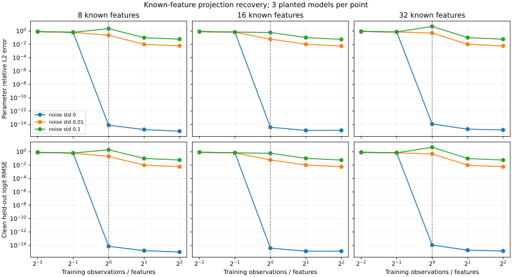

# Measured cloud results

These trials ran on CPU on 2026-11-06. They answer different questions and must not be combined into one recovery-accuracy claim.

| Experiment | Access and budget | Result |
| --- | --- | --- |
| Controlled affine recovery | Known features and full logits; 192 training/64 test rows | About `9.1e-16` parameter relative error; 100% held-out top-1 agreement |
| Synthetic tiny-Qwen reconstruction | Untrained 22,816-parameter teacher, 48 queried prompts, two random candidates at 64 steps each | Validation-selected candidate: 87.5% teacher-forced recorded-token agreement on 40 test tokens; 70% exact match across ten test prompts |
| Pretrained Qwen selected-head recovery | Actual hidden features and logits; 3,072 train positions, 32 selected vocabulary rows | `1.2623e-5` parameter relative error for 28,672 weights; 100% selected-vocabulary top-1 agreement on held-out positions |
| Pretrained Qwen smaller-student smoke | 9,798,208-parameter random student, 48 training continuation tokens, 32 optimization steps | Validation CE `11.933 → 11.656`; 0/16 recorded test tokens matched and 0/2 greedy completions matched |

## Real pretrained reference

The reference was `Qwen/Qwen2.5-0.5B-Instruct`, revision `7ae557604adf67be50417f59c2c2f167def9a775`. The downloaded safetensors SHA256 was `fdf756fa7fcbe7404d5c60e26bff1a0c8b8aa1f72ced49e7dd0210fe288fb7fe`. It was loaded for float32 CPU inference with two Torch threads. The repository contains no copy of its weights.

### Restricted component identification

A fixed [128-prompt suite](../examples/projection-prompts.jsonl) was prepared before running the experiment. Prompt groups were split into 96 training and 32 test prompts. The estimator observed the actual tensor entering the output head and 32 selected output logits at each position. It estimated those selected head weights without using the reference weight values; reference weights were read afterwards to score recovery.

The 896-dimensional training design had rank 896 and condition number about 54,662. Weight relative L2 error was `1.2623e-5`; overall held-out selected-logit RMSE was `1.4704e-6`. Shared chat prefixes caused 549 of 1,024 test feature rows to repeat training features. On the remaining **475 novel feature rows**, RMSE was `2.1479e-6` and selected-vocabulary top-1 agreement remained 100%. Float32 forward-versus-double-projection calculation error was already around `1.26e-6`.

Only 32 of 151,936 vocabulary rows were recovered, using observed internal features. This establishes recovery for that restricted component under stronger access. It does not establish text-only recovery of the backbone or the full output head. See [the complete report](../examples/results/qwen-projection.json) and [component methodology](COMPONENT_RECOVERY.md).

### Smaller behavioral student

The starter prompt file produced 80 total completion tokens across 12 prompts. Grouped splitting yielded eight train prompts with 48 continuation tokens, two validation prompts with 16 tokens, and two test prompts with 16 tokens. The student had two layers, hidden size 64, the reference vocabulary/tokenizer, and random initialization. It received no reference weights as an initialization or frozen backbone.

The fixed run used seed 42, learning rate `0.0005`, a 50/50 recorded-token/top-k-residual loss mixture, and 32 optimizer steps. Best-checkpoint selection used validation only. Its test continuation CE was `11.606`; token and free-generation agreement were both zero. This tiny evidence/compute budget is a pipeline and memory smoke test. It provides neither useful reconstruction accuracy nor an estimate of what a much larger trial could achieve.

[Evidence, splits, configuration, file hashes, and raw reports](../examples/results/qwen-cloud/) are included for inspection. Raw reports retain original execution paths for provenance. Reproduce the pipeline using the commands in [EXPERIMENTS.md](EXPERIMENTS.md), the pinned reference revision above, and the copied student configuration. Numerical reproducibility depends on the recorded library stack and hardware.

## Offline integration and evidence budgets

The synthetic trial's [full report](../examples/results/offline-trial.json), [summary](../examples/results/offline-trial.md), and [comparison tables/curves](../examples/results/offline-comparison/) are included. It chooses between token-only and top-k candidates on a common validation continuation-loss metric, then evaluates the chosen candidate on test once. Its high agreement concerns a small untrained teacher with a 64-token vocabulary.

The [controlled budget/noise results](../examples/results/component-budget.json) show how affine identification changes with sample count, rank, and observation noise. These are planted experiments with known assumptions, not empirical evidence for whole-transformer identifiability.

## Remaining empirical work

The runnable v0.2 toolkit is complete. Stronger pretrained behavioral reconstruction needs substantially more varied evidence, a justified candidate/prior, and an appropriate optimization budget. Broad accuracy estimates need larger independent test families and repeated seeds. GPU/MPS behavior and performance on a particular computer need those devices. These are empirical limits, not successful results hidden by a different metric.
