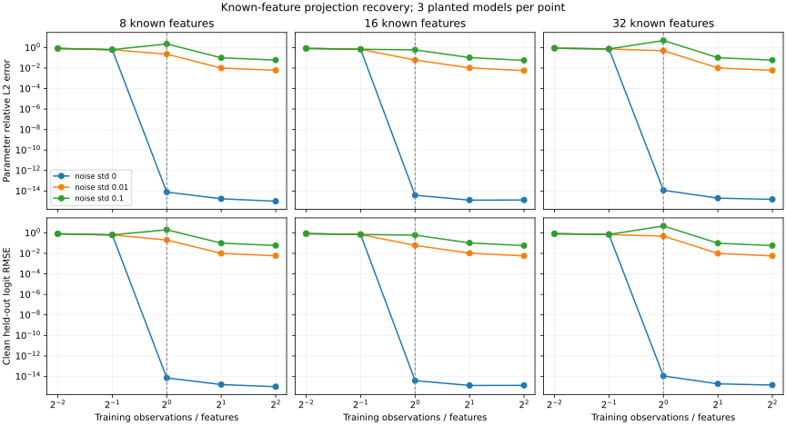

# Recover an open model's output projection

`recover-projection` tests whether known hidden features and observed logits determine selected columns of the model's output projection. It captures the tensor actually passed to `get_output_embeddings()` with a forward pre-hook, rather than assuming that a generic hidden-state field matches the projection input.

This experiment requires **white-box access to final hidden activations**. Prompts, visible reasoning, and responses alone do not provide those activations. The result therefore describes component identification under an additional observation assumption, not text-only recovery of a transformer.

```bash
rephix recover-projection \
  --model models/qwen2.5-0.5b-instruct \
  --prompts examples/prompts.jsonl \
  --output runs/projection \
  --vocab-limit 64 --max-samples 4096 --max-seq-length 128 --device cpu
```

The command splits independent prompt groups before observing any positions. Repeated prompts and `metadata.group_id` remain together. It runs the model over the prompt tokens, then reservoir-samples positions separately in the train and test groups. The held-out logits are not used to fit the projection. The defaults cap stored samples and estimate array memory before collection; reduce `--max-samples` or the selected vocabulary if needed.

`--max-memory-mb` bounds estimated observation arrays, selected reference weights, and solver copies. It does not bound the loaded model, temporary full-vocabulary forward logits, or total process memory. Lower the sequence length to reduce forward memory.

`--vocab-limit 64` selects 64 evenly spaced vocabulary IDs. `--token-ids 10,20,30` selects exact IDs instead. `--vocab-limit 0` requests the whole vocabulary and may need a much smaller sample budget or a larger explicit `--max-memory-mb` budget. Reported top-1 agreement is **within the selected vocabulary**, not full-model generation agreement.

The recovery solve receives only the captured input features and output logits. The reference weights are read after fitting to calculate parameter error and verify that the emitted model logits correspond to the captured affine projection. Models that apply an additional logit transform outside their output projection are rejected. Only a standard linear output projection is supported.

`--bias-mode auto` constrains the bias to zero when the architecture has no output bias, otherwise it fits an affine intercept. `--bias-mode fit` can estimate an intercept explicitly. `--bias-mode known-zero` is rejected if the model has a bias parameter. `--ridge` supplies optional numerical regularization; it does not change the rank-based identifiability assessment.

The output directory contains:

- `recovered.npz`: estimated weights, bias, and JSON diagnostics.
- `observations.npz`: sampled train/test features and logits with prompt IDs and positions.
- `reference.npz`: selected reference weights and token IDs, used only to measure recovery.
- `report.json`: rank, conditioning, sample counts, parameter error, held-out logit error, and selected-vocabulary agreement.

All NumPy files can be read with `allow_pickle=False`. If the observed feature matrix is rank deficient, the report says the weights are not uniquely identifiable even when the sampled outputs fit well. A small prompt file may not span Qwen's hidden dimension; add varied independent prompts to increase the available rank. The offline test suite separately verifies recovery of a randomly initialized tiny Qwen2 projection from actual head inputs on held-out prompt groups.

Shared chat prefixes can produce exactly repeated feature rows even when the prompt groups are disjoint. `heldout_feature_novelty` reports that overlap and evaluates the subset of held-out feature rows that never appeared in training. This is an additional diagnostic; it does not change the fixed split or the estimator.

## Pretrained Qwen component trial

The first cloud trial used `Qwen/Qwen2.5-0.5B-Instruct`, revision `7ae557604adf67be50417f59c2c2f167def9a775`, loaded as FP32 on CPU with two threads. The checkpoint's SHA256 and library versions are recorded in [`examples/results/qwen-projection.json`](../examples/results/qwen-projection.json). Weights and captured hidden activations remain outside the committed source.

The deterministic [`examples/projection-prompts.jsonl`](../examples/projection-prompts.jsonl) suite contains 128 prompts across 16 task families. It was frozen before collecting this trial, with no selection or configuration changes based on held-out results. Individual prompt IDs define the groups; task templates are shared across the splits, so this is not a test of generalization to unseen task families. The model observed the first 64 tokens of each rendered chat prompt. All 128 prompts exceeded that input-window budget and were truncated accordingly.

| Measurement | Result |
| --- | --- |
| Selected output rows | 32 of 151,936 |
| Recovered weight parameters | 28,672 |
| Training prompt groups / positions | 96 / 3,072 |
| Test prompt groups / positions | 32 / 1,024 |
| Observed feature rank | 896 of 896 |
| Design condition number | About 54,662 |
| Parameter relative L2 error | `1.2623e-5` |
| Held-out selected-logit RMSE | `1.4704e-6` |
| Held-out selected-vocabulary top-1 agreement | 100% |
| Test rows exactly matching a training feature | 549 |
| Novel test-feature rows | 475 |
| Novel-feature selected-logit RMSE / top-1 agreement | `2.1479e-6` / 100% |

The reference FP32 forward pass differs from a NumPy FP64 evaluation of the same head by about `1.2591e-6` RMSE on the held-out features. That numerical discrepancy helps interpret the recovered projection's error. The condition number also shows that some parameter directions are much less strongly constrained than others.

This is evidence of accurate recovery for the stated **known-feature, selected-output-component problem**. It does not recover the full language model, provide a text-only extraction method, or establish behavioral reconstruction of Qwen. The estimator never received reference weight values; they were read after the solve to measure error.

Reproduce the fixed experiment with a fresh output directory:

```bash
OMP_NUM_THREADS=2 MKL_NUM_THREADS=2 OPENBLAS_NUM_THREADS=2 \
rephix recover-projection --model "$QWEN_MODEL" \
  --prompts examples/projection-prompts.jsonl \
  --output runs/qwen-projection-128-v1 \
  --max-seq-length 64 --max-samples 4096 --vocab-limit 32 \
  --max-memory-mb 512 --device cpu --seed 42
```

## Observation budgets and noise

[`examples/results/component-budget.json`](../examples/results/component-budget.json) records a reproducible synthetic study with 8, 16, and 32 known Gaussian features, five output classes, and observation budgets from one quarter to four times the feature count. Each point averages three independently planted models. Noise is added only to training logits; test logits come from the clean planted function on new features.

Below the feature count, least squares can fit the observed logits while recovering neither the original parameters nor unseen outputs. With full-rank noiseless observations, recovery reaches numerical precision. Noisy observations produce estimation error even at full rank; more independent observations generally reduce that error. Square systems can be poorly conditioned and amplify noise. Rank identifies uniqueness under exact observations, not robustness under noisy ones.



The plot is a standard Matplotlib SVG that can be shared independently. These controlled curves do not measure a pretrained Qwen model. Regenerate them from Python with `projection_demo(seed=42)`, `rephix.io.write_json`, and `plot_projection_demo`; the offline trial harness also includes this experiment.
